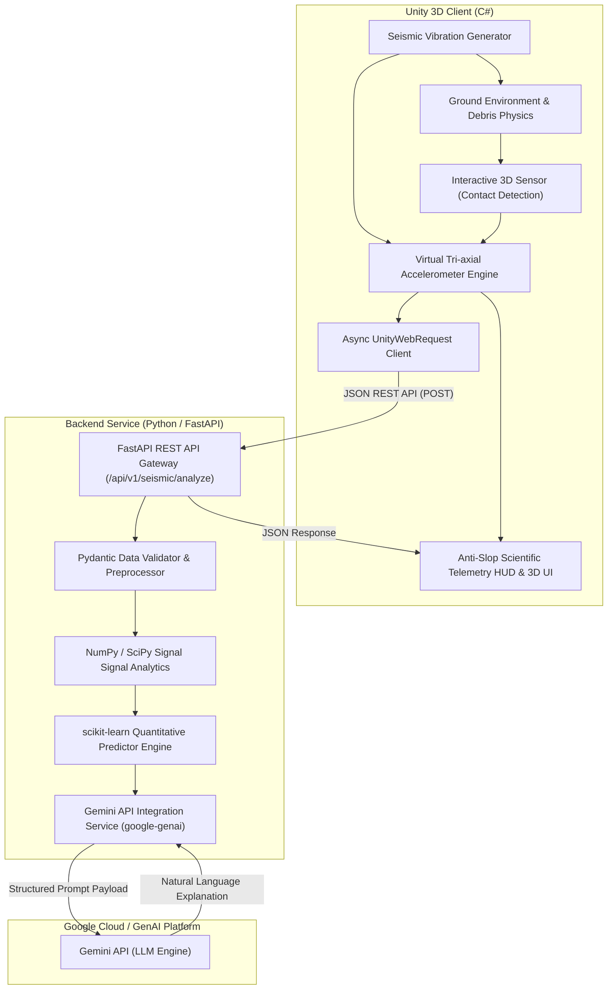

# Kiến trúc Hệ thống: AI Earthquake Analysis System

Document Version: 1.0.0  
Last Updated: 2026-09-27  
Status: Architectural Specification (Draft / Baseline)

---

## 1. Tổng quan Kiến trúc (System Architecture Overview)

Hệ thống **AI Earthquake Analysis System** được thiết kế dựa trên mô hình phản hồi thời gian thực giữa môi trường mô phỏng vật lý 3D (Unity) và Backend xử lý dữ liệu thông minh (Python FastAPI + scikit-learn + Gemini API).

Hệ thống kết hợp 3 tầng chính:
1. **Front-End & Simulation Layer (Unity 3D)**: Quản lý môi trường vật lý, tiếp xúc mặt đất (Contact Detection), mô phỏng rung chấn địa chấn thời gian thực, sinh chuỗi dữ liệu Virtual Sensor và hiển thị giao diện Telemetry Dashboard theo chuẩn thiết kế **Anti-Slop Scientific Interface**.
2. **Backend & Quantitative Engine Layer (Python FastAPI + scikit-learn / NumPy)**: Nhận payload telemetry từ Unity qua REST API, xử lý và trích xuất đặc trưng chuỗi thời gian (Signal Feature Extraction), thực hiện dự đoán định lượng địa chấn (Magnitude, MMI Intensity Class, Risk Index) bằng mô hình Machine Learning.
3. **Generative Intelligence Layer (Gemini API)**: Chuyển đổi dữ liệu định lượng và thông số vật lý thành nhận xét, giải thích tự nhiên chuẩn khoa học, đề xuất cảnh báo an toàn công trình dành cho người dùng.

---

## 2. Ranh giới Chi tiết Các Module

### 2.1. Module Unity 3D & Telemetry Layer (Unity C#)

Module Unity đóng vai trò là môi trường tương tác 3D và trạm thu thập dữ liệu (Telemetry Collection Hub).

#### A. Subsystem Physics Environment & Debris
- **Nhiệm vụ**: Dựng mặt đất (Ground Surface Terrain/Mesh) và các vật thể phụ trợ (mảnh vỡ, sắt vụn, hộp kim loại) sử dụng Unity Physics Engine (`Rigidbody`, `MeshCollider`, `BoxCollider`).
- **Chế độ Rung chấn (Seismic Shaker)**: Áp dụng lực gia tốc/biến dạng vật lý thời gian thực lên mặt đất theo các mẫu dạng sóng động đất thực tế (dữ liệu lịch sử USGS/PEER) hoặc dạng sóng tổng hợp (Harmonic Noise Waves).
- **Phản ứng Vật lý**: Vật thể nhỏ trên mặt đất sẽ nảy, trượt hoặc văng theo đúng vector lực gia tốc rung chấn.

#### B. Subsystem Contact Detection (Thiết bị 3D & Tiếp xúc Mặt đất)
- **Nhiệm vụ**: Xác định chính xác trạng thái tiếp xúc vật lý giữa chân đế thiết bị cảm biến và mặt đất.
- **Cơ chế xác thực**:
  - Tích hợp `OnCollisionStay` / `OnTriggerStay` kết hợp với **Raycast Multi-point Check** để xác định độ phẳng và diện tích tiếp xúc.
  - Kiểm tra độ võng và góc lệch của Contact Normal Vector so với phương thẳng đứng (Gravity Vector).
- **Trạng thái Contact State**:
  - `DISCONNECTED`: Cảm biến đang lơ lửng hoặc nhấc khỏi mặt đất (Ngắt thu thập telemetry).
  - `PARTIAL_CONTACT`: Cảm biến bấp bênh, nghiêng lệch (Cảnh báo nhiễu dữ liệu).
  - `CONTACT_ESTABLISHED`: Tiếp xúc hoàn toàn, sẵn sàng ghi nhận gia tốc địa chấn.

#### C. Subsystem Virtual Sensor Telemetry Engine
- **Nhiệm vụ**: Giả lập cảm biến gia tốc 3 trục (Tri-axial Accelerometer: $a_x, a_y, a_z$) đo đạc biến thiên gia tốc theo thời gian thực tại tần số lấy mẫu $f_s = 100\text{ Hz}$.
- **Bộ thông số trích xuất tại C# (Real-time Buffering)**:
  1. **Tri-axial Acceleration Vectors**: Chuỗi thời gian gia tốc $a_x(t), a_y(t), a_z(t)$ trong cửa sổ thời gian (ví dụ: $5.0\text{ seconds}$).
  2. **Peak Ground Acceleration (PGA)**: $\text{PGA} = \max \sqrt{a_x^2(t) + a_y^2(t) + a_z^2(t)}$ tính bằng g ($1\text{g} \approx 9.81\text{ m/s}^2$).
  3. **Root Mean Square Acceleration (RMS)**: $\text{RMS} = \sqrt{\frac{1}{N} \sum_{i=1}^{N} (a_{x,i}^2 + a_{y,i}^2 + a_{z,i}^2)}$.
  4. **Dominant Frequency ($f_d$)**: Tần số thống trị thu được qua giải thuật Fast Fourier Transform (FFT) trên chuỗi dữ liệu tổng hợp.
  5. **Signal Duration ($T_d$)**: Khoảng thời gian rung động vượt quá ngưỡng kích hoạt noise floor ($\text{threshold} \ge 0.02\text{g}$).

#### D. Subsystem Anti-Slop Scientific Telemetry HUD & 3D UI
- **Nguyên lý Thiết kế (Tuân thủ Design-Taste-Frontend Skill)**:
  - **Typography**: Sử dụng phông chữ Monospace sắc nét (JetBrains Mono / Space Mono / IBM Plex Mono) cho toàn bộ các chỉ số telemetry số, thông số đo đạc và tọa độ.
  - **Grid System**: Cấu trúc lưới khoa học 1px Hairline (`rgba(255,255,255,0.12)`), phân vùng dữ liệu rõ ràng theo các mô-đun chức năng (Device Status, Signal Waveform, ML Predictions, AI Insight).
  - **Color Palette**: Tông màu tối khoa học / quân sự (Deep Slate `#0A0D12` nền chính, `#161B22` nền panel, `#00F0FF` Electric Cyan cho trạng thái sensor hoạt động, `#00E676` Emerald cho tín hiệu ổn định, `#FF3366` Crimson cho cảnh báo vượt ngưỡng động đất).
  - **Zero Visual Slop**: Loại bỏ hoàn toàn hiệu ứng lóa gradient AI tím/hồng rập khuôn, loại bỏ bo góc quá đà (chỉ dùng corner radius 0px - 4px sắc nét), loại bỏ các hoạt ảnh vô nghĩa không mang mục đích hiển thị thông tin.
- **Thành phần Giao diện**:
  - **World-Space 3D UI**: Bản điều khiển nhỏ gắn trực tiếp trên thân máy đo 3D (hiển thị LED trạng thái tiếp xúc, giá trị PGA tức thời và mã kết nối API).
  - **Screen-Space Telemetry Dashboard**: Bảng điều khiển trung tâm toàn màn hình hiển thị đồ thị sóng gia tốc 3 trục, thông số thống kê, bảng phân tích định lượng ML và khung hiển thị văn bản giải thích tự nhiên từ Gemini API.

---

### 2.2. Module Backend (Python / FastAPI Layer)

Module Backend hoạt động như một REST API Server hiệu năng cao, đóng vai trò trung gian nhận dữ liệu từ Unity, điều phối quá trình tính toán định lượng và tương tác với AI Engine.

- **FastAPI Gateway**: Cung cấp API endpoints chuẩn chuẩn hóa, quản lý CORS, xác thực JSON payload với Pydantic Models V2, quản lý exception và log.
- **Signal Analytics Service (NumPy / SciPy)**: Kiểm tra tính toàn vẹn của chuỗi dữ liệu (Data Integrity Check), lọc nhiễu tần số cao (Butterworth Bandpass Filter nếu cần), chuẩn hóa dữ liệu đầu vào cho ML Model.
- **Async Execution Pipeline**: Sử dụng `asyncio` giúp xử lý đồng thời nhiều request telemetry từ Unity mà không gây block main event loop.

---

### 2.3. Module Machine Learning (scikit-learn / NumPy Engine)

Module Machine Learning đảm nhận vai trò **phân tích định lượng (Quantitative Analysis)** mang tính chính xác và nhất quán.

- **Đầu vào (Features)**:
  - `peak_acceleration_g` (PGA)
  - `rms_acceleration` (RMS)
  - `dominant_frequency_hz` ($f_d$)
  - `signal_duration_s` ($T_d$)
  - `cumulative_absolute_velocity` (CAV)
  - `axis_energy_ratio` ($E_x : E_y : E_z$)
- **Mô hình & Nhiệm vụ Dự đoán**:
  1. **Magnitude Estimator ($M_w$)**: Mô hình `RandomForestRegressor` hoặc `GradientBoostingRegressor` ước tính độ lớn trận động đất theo thang Moment Magnitude Scale.
  2. **MMI Intensity Classifier**: Mô hình `RandomForestClassifier` phân loại mức độ chấn động theo thang Modified Mercalli Intensity (cấp I đến cấp XII).
  3. **Structural Risk Score Index**: Mô hình đa thông số tính toán chỉ số rủi ro kết cấu công trình (0% - 100%) dựa trên mối tương quan giữa tần số thống trị và độ gia tốc đỉnh.
- **Đầu ra**: Tập hợp các tham số định lượng tinh gọn, được trả về dưới dạng Pydantic object để đưa vào Gemini Engine.

---

### 2.4. Module Gemini AI Explanation (Google GenAI Engine)

Module Gemini API đảm nhận vai trò **giải thích tự nhiên (Qualitative & Explanatory Analysis)**.

- **Nhiệm vụ**: Chuyển đổi dữ liệu thô và các chỉ số ML định lượng thành báo cáo nhận định chuyên sâu, viết bằng ngôn ngữ tự nhiên khoa học, dễ hiểu nhưng đầy đủ tính chuyên môn.
- **Prompt Engineering Strategy**:
  - Đóng vai: *Chuyên gia Địa chấn học & Kỹ sư Động đất Công trình (Senior Seismologist & Structural Dynamics Specialist)*.
  - Nguyện liệu Prompt: Kết hợp `sensor_metadata`, `computed_metrics`, `quantitative_ml_results` và `ground_contact_integrity`.
  - Quy định Output Format: Yêu cầu Gemini trả về nội dung theo JSON / Markdown phân định rõ 4 mục:
    1. **Executive Summary** (Tóm tắt diễn biến chấn động).
    2. **Wave Physics Interpretation** (Phân tích đặc tính sóng địa chấn và phản ứng chuyển động).
    3. **Structural Impact & Hazard Assessment** (Đánh giá mức độ ảnh hưởng đến hạ tầng / công trình).
    4. **Safety & Emergency Recommendations** (Khuyến nghị hành động ứng phó).
- **Cấu hình API**: Set `temperature = 0.2` để giảm tối đa tính sáng tạo ngẫu nhiên, đảm bảo câu từ nhất quán, chính xác theo chuẩn dữ liệu địa chấn.

---

## 3. Ma trận Ranh giới Trách nhiệm (Responsibility Matrix)

| Thành phần | Unity 3D Client | Python FastAPI | scikit-learn ML | Gemini AI API |
| :--- | :---: | :---: | :---: | :---: |
| **Physics Simulation & Debris** | **Chủ trì** | Không | Không | Không |
| **Ground Contact Detection** | **Chủ trì** | Không | Không | Không |
| **Tri-axial Sampling & Buffer** | **Chủ trì** | Phụ (Validate) | Không | Không |
| **PGA / RMS / Duration Computation** | **Chủ trì** | Xử lý lại/Validate | Không | Không |
| **Magnitude & MMI Prediction** | Không | Tiếp nhận | **Chủ trì** | Không |
| **Structural Risk Scoring** | Không | Tiếp nhận | **Chủ trì** | Không |
| **Natural Language Interpretation** | Không | Tiếp nhận | Không | **Chủ trì** |
| **Emergency Recommendations** | Không | Tiếp nhận | Không | **Chủ trì** |
| **Anti-Slop Telemetry HUD Display** | **Chủ trì** | Không | Không | Không |

---

## 4. Tối ưu Hiệu năng & Rủi ro Kiến trúc (Performance & Risk Controls)

1. **Giảm thiểu Độ trễ (Latency Management)**:
   - Các phép tính đặc trưng vật lý gia tốc cơ bản ($PGA, RMS, f_d$) được thực hiện ngay tại Unity C# local buffer nhằm hiển thị chỉ số tức thì trên Telemetry HUD (< 5ms).
   - Dự đoán ML tại Backend hoàn tất trong < 20ms.
   - Gọi Gemini API chạy theo cơ chế bất đồng bộ (`asyncio`), có cơ chế Fallback Rule-Based Text Generator phòng trường hợp mạng chậm hoặc Gemini API bị giới hạn quota.
2. **Xử lý Mất Tiếp xúc Đất (Contact Loss Handling)**:
   - Nếu trong quá trình chấn động, thiết bị nảy lên làm ngắt tiếp xúc mặt đất (`ground_contact_established = false`), Unity sẽ đánh dấu cờ `contact_integrity_warning` vào payload.
   - Backend & Gemini sẽ tự động điều chỉnh độ tin cậy của phân tích (Confidence Score Reduction) và cảnh báo nhiễu do lỗi lắp đặt cảm biến.
