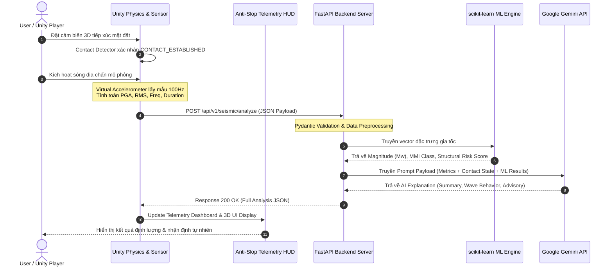

# Quy chuẩn Luồng Dữ liệu & API Specification: AI Earthquake Analysis System

Document Version: 1.0.0  
Last Updated: 2026-09-27  
Status: Data Protocol & API Schema Specification

---

## 1. Sơ đồ Luồng Dữ liệu End-to-End (Data Flow Sequence)

Dữ liệu di chuyển tuần tự qua 6 bước chính từ môi trường mô phỏng vật lý 3D trong Unity đến Backend xử lý trí tuệ nhân tạo và hiển thị trở lại giao diện Telemetry HUD:

1. **Physical Contact & Shaker Trigger**: Người dùng thả cảm biến 3D xuống mặt đất $\rightarrow$ Kích hoạt `GroundContactDetector` xác nhận trạng thái tiếp xúc $\rightarrow$ Kích hoạt sóng chấn động địa chấn.
2. **Telemetry Buffering & Feature Calculation**: Virtual Sensor thu thập gia tốc 3 trục $a_x(t), a_y(t), a_z(t)$ $\rightarrow$ Thuật toán C# tính toán PGA, RMS, Dominant Frequency ($f_d$) và Signal Duration ($T_d$).
3. **Async REST Dispatch**: Unity đóng gói dữ liệu thành JSON Payload $\rightarrow$ Gửi HTTP POST request đến FastAPI Backend.
4. **Data Validation & ML Quantitative Processing**: FastAPI Gateway xác thực schema bằng Pydantic V2 $\rightarrow$ NumPy/SciPy lọc nhiễu $\rightarrow$ scikit-learn Model dự đoán Moment Magnitude ($M_w$), Cấp MMI và Structural Risk Score.
5. **Gemini AI Natural Language Synthesis**: FastAPI chuyển tập hợp chỉ số đo và dự đoán ML vào Gemini API với Structured Prompting $\rightarrow$ Gemini sinh nhận định khoa học tự nhiên.
6. **HUD Dashboard Rendering**: Response JSON hợp nhất trả về Unity $\rightarrow$ Parser đưa kết quả lên Anti-Slop Telemetry HUD và World-Space 3D UI.



---

## 2. Danh sách Endpoints REST API

Tất cả các API Endpoints đều chạy trên cổng mặc định `8000` (hoặc cổng cấu hình) với base URL: `http://localhost:8000`.

| Method | Endpoint | Description | Authentication |
| :--- | :--- | :--- | :--- |
| `GET` | `/health` | Kiểm tra sức khỏe hệ thống FastAPI Backend & Gemini API Readiness | None |
| `POST` | `/api/v1/seismic/analyze` | Tiếp nhận telemetry địa chấn từ Unity, thực hiện phân tích ML & sinh nhận xét Gemini AI | None (Internal Protocol) |

---

## 3. Schema Request: Unity 3D $\rightarrow$ FastAPI Backend

### Endpoint: `POST /api/v1/seismic/analyze`

#### Request Headers
```http
Content-Type: application/json
Accept: application/json
User-Agent: Unity-SeismicTelemetryClient/1.0
```

#### JSON Payload Schema (Request Body)
```json
{
  "session_id": "string (UUIDv4)",
  "timestamp": "string (ISO-8601 UTC timestamp)",
  "sensor_metadata": {
    "device_id": "string",
    "ground_contact_established": "boolean",
    "contact_force_n": "number (float, Newton)",
    "surface_alignment_deg": "number (float, angle offset from gravity vector)",
    "surface_material": "string"
  },
  "raw_telemetry": {
    "sampling_rate_hz": "integer (e.g. 100)",
    "sample_count": "integer",
    "acceleration_x": ["array of float (g-force)"],
    "acceleration_y": ["array of float (g-force)"],
    "acceleration_z": ["array of float (g-force)"]
  },
  "computed_metrics": {
    "peak_acceleration_g": "number (float, PGA in g)",
    "rms_acceleration": "number (float, RMS in g)",
    "dominant_frequency_hz": "number (float, Hz)",
    "signal_duration_s": "number (float, seconds)",
    "cumulative_absolute_velocity": "number (float, CAV)"
  }
}
```

#### Request Payload Mẫu (Concrete JSON Example)
```json
{
  "session_id": "8f3b2e91-4c12-4d89-a3bf-9a2c10b771e4",
  "timestamp": "2026-09-27T15:30:00.000Z",
  "sensor_metadata": {
    "device_id": "SEISMIC_PROBE_ALPHA_01",
    "ground_contact_established": true,
    "contact_force_n": 48.5,
    "surface_alignment_deg": 1.2,
    "surface_material": "Compacted_Soil_Bed"
  },
  "raw_telemetry": {
    "sampling_rate_hz": 100,
    "sample_count": 10,
    "acceleration_x": [0.012, 0.045, 0.128, 0.342, 0.512, 0.421, 0.210, 0.089, 0.031, 0.005],
    "acceleration_y": [0.008, 0.021, 0.095, 0.210, 0.380, 0.290, 0.150, 0.065, 0.018, 0.002],
    "acceleration_z": [0.981, 0.995, 1.120, 1.340, 1.580, 1.410, 1.180, 1.020, 0.988, 0.980]
  },
  "computed_metrics": {
    "peak_acceleration_g": 0.625,
    "rms_acceleration": 0.284,
    "dominant_frequency_hz": 3.45,
    "signal_duration_s": 4.80,
    "cumulative_absolute_velocity": 1.42
  }
}
```

---

## 4. Schema Response: FastAPI Backend $\rightarrow$ Unity 3D

### Response HTTP Status: `200 OK`

#### JSON Response Schema (Response Body)
```json
{
  "analysis_id": "string (UUIDv4)",
  "session_id": "string (UUIDv4 matching request)",
  "timestamp": "string (ISO-8601 UTC timestamp)",
  "status": "string ('SUCCESS' | 'WARNING_CONTACT_DEGRADED' | 'ERROR')",
  "execution_time_ms": "number (float)",
  "quantitative_analysis": {
    "estimated_magnitude_mw": "number (float, Moment Magnitude)",
    "mmi_intensity_class": "string (Roman numerals: 'I' to 'XII')",
    "mmi_intensity_label": "string (e.g. 'Strong', 'Very Strong', 'Severe')",
    "peak_ground_acceleration_g": "number (float)",
    "structural_risk_index_percent": "number (float, 0.0 to 100.0)",
    "hazard_level": "string ('LOW' | 'MODERATE' | 'HIGH' | 'CRITICAL')"
  },
  "ai_explanation": {
    "executive_summary": "string",
    "wave_behavior_analysis": "string",
    "structural_impact_assessment": "string",
    "emergency_advisory": "string"
  },
  "telemetry_quality": {
    "contact_integrity": "string ('OPTIMAL' | 'DEGRADED' | 'INVALID')",
    "signal_noise_ratio_db": "number (float)",
    "confidence_score": "number (float, 0.0 to 1.0)"
  }
}
```

#### Response Payload Mẫu (Concrete JSON Example)
```json
{
  "analysis_id": "d91a7e42-118f-49b2-93cb-66b907f15e88",
  "session_id": "8f3b2e91-4c12-4d89-a3bf-9a2c10b771e4",
  "timestamp": "2026-09-27T15:30:00.850Z",
  "status": "SUCCESS",
  "execution_time_ms": 345.2,
  "quantitative_analysis": {
    "estimated_magnitude_mw": 5.8,
    "mmi_intensity_class": "VI",
    "mmi_intensity_label": "Strong Shaking",
    "peak_ground_acceleration_g": 0.625,
    "structural_risk_index_percent": 64.5,
    "hazard_level": "HIGH"
  },
  "ai_explanation": {
    "executive_summary": "Ghi nhận trận động đất có độ lớn ước tính 5.8 Mw với gia tốc đỉnh PGA đạt 0.625g. Chấn động thuộc cấp VI (Strong Shaking) theo thang Mercalli.",
    "wave_behavior_analysis": "Sóng gia tốc cho thấy biên độ dao động mạnh tập trung ở tần số thống trị 3.45 Hz. Chuyển động ngang chiếm ưu thế gây tác động trượt lên các vật thể tự do trên bề mặt.",
    "structural_impact_assessment": "Chỉ số rủi ro kết cấu đạt 64.5%. Tần số 3.45 Hz nằm cận kề vùng tần số riêng của các công trình thấp tầng đến trung tầng (3-7 tầng), có nguy cơ gây nứt tường phi kết cấu và xô lệch vật thể chưa cố định.",
    "emergency_advisory": "Khuyến cáo kích hoạt quy trình kiểm tra an toàn kết cấu. Di dời vật thể nhỏ/sắt vụn khỏi các mép cao và chuẩn bị cho các đợt dư chấn (aftershocks) có thể xảy ra."
  },
  "telemetry_quality": {
    "contact_integrity": "OPTIMAL",
    "signal_noise_ratio_db": 28.4,
    "confidence_score": 0.94
  }
}
```

---

## 5. Quy chuẩn Mã Lỗi & HTTP Status Codes

Hệ thống tuân thủ nghiêm ngặt chuẩn mã phản hồi HTTP. Trong trường hợp xảy ra lỗi, Backend sẽ trả về `Error Payload` với cấu trúc thống nhất.

#### HTTP Status Codes
- `200 OK`: Request được xử lý thành công.
- `400 Bad Request`: Payload không đúng định dạng (thiếu trường dữ liệu bắt buộc hoặc giá trị vô lý như gia tốc âm).
- `422 Unprocessable Entity`: Lỗi Pydantic Validation (ví dụ: mảng dữ liệu raw acceleration bị rỗng).
- `500 Internal Server Error`: Lỗi phát sinh trong ML Predictor hoặc Backend Service.
- `503 Service Unavailable`: Lỗi mất kết nối tới Gemini API và hệ thống chưa kích hoạt được Fallback.

#### Schema Payload Báo Lỗi (Error JSON Response)
```json
{
  "error_code": "INVALID_TELEMETRY_DATA",
  "message": "Trường 'acceleration_x' rỗng hoặc chứa dữ liệu không hợp lệ.",
  "details": {
    "field": "raw_telemetry.acceleration_x",
    "issue": "Array length must be > 0"
  },
  "timestamp": "2026-09-27T15:30:01.100Z"
}
```
